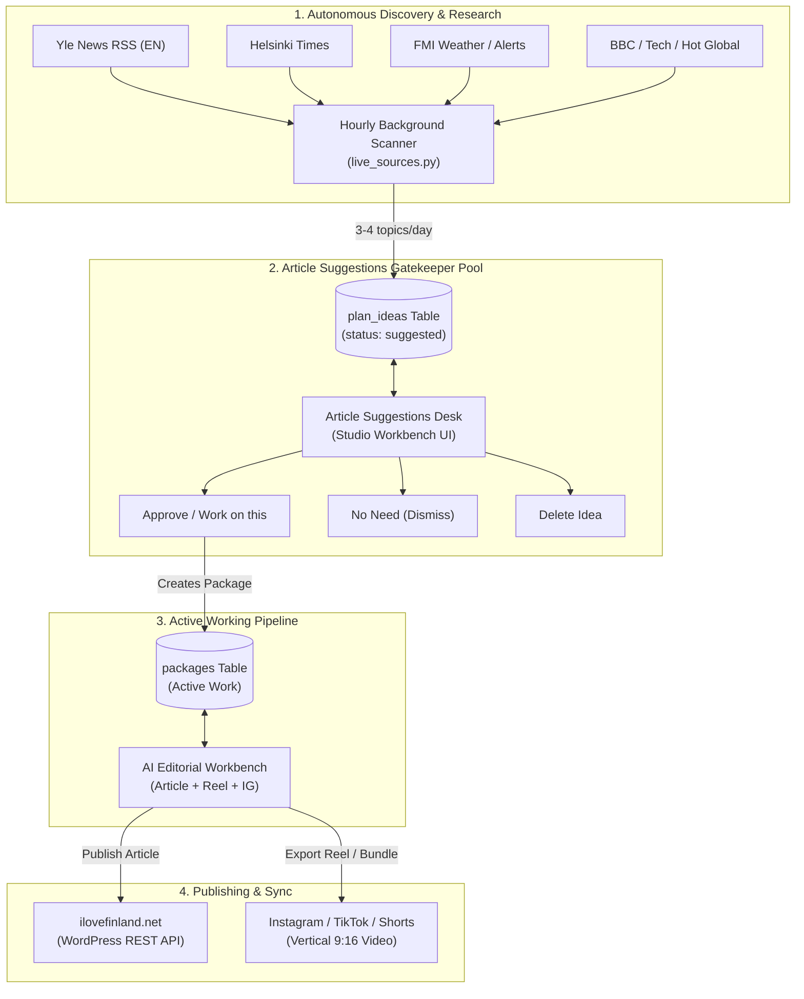

# ILoveFinland Studio Workbench — Complete AI Architecture & Operational Specification

> **Target Audience:** Any AI Assistant (Gemini, Claude, GPT-4, etc.) or Software Engineer collaborating on the ILoveFinland media platform.
> **Last Updated:** November 2026
> **Platform Version:** ILoveFinland Studio v2.4 (Bilingual EN/FI)

---

## 1. Executive Summary & Purpose

**ILoveFinland Studio Workbench** is an automated, web-based digital newsroom and content production studio built specifically for **ilovefinland.net** and its social media channels (Instagram, TikTok, YouTube Shorts, Facebook).

### The Core Problem Solved
Small editorial teams and solo creators struggle to maintain daily, high-quality bilingual (English & Finnish) coverage across multiple formats:
- Long-form web articles with verified sources and SEO structure.
- Vertical video Reels (9:16) for TikTok, Reels, and Shorts.
- Instagram multi-slide carousels (4:5) for visual engagement.

### The Studio Solution
Studio Workbench acts as an intelligent co-pilot that:
1. **Discovers & Researches** Finnish breaking news, living guides, and hot international topics 24/7.
2. **Holds Suggestions in a Gatekeeper Pool**: Ideas *never* enter the active working pipeline automatically. The human editor approves ("Start Project / Work on this"), dismisses ("No need"), or deletes them.
3. **Drafts Multi-Format Content**: Once approved, the AI generates the complete bundle: article text, bilingual tags, short video scripts with shot-by-shot b-roll guides, and carousel slide copy.
4. **Enables Direct In-App Editing & Live Preview**: The editor refines the text, swaps clips, or reviews AI-generated artwork directly in the browser.
5. **Directly Publishes & Syncs**: Publishes articles directly to WordPress (`ilovefinland.net`) and schedules vertical video assets without external dependencies.

---

## 2. System Architecture & Tech Stack



### Technology Breakdown
- **Backend:** Python 3 (Native `http.server.ThreadingHTTPServer` + SQLite3). Zero bloated frameworks; starts in <1 second and runs reliably on local networks or servers.
- **Frontend:** Vanilla ES2022 JavaScript, semantic HTML5, modern CSS3 with custom variables (`--navy`, `--ice-blue`, `--accent`), Lucide SVGs. Fully responsive across desktop, iPad, and mobile phone.
- **Database:** Single file SQLite (`studio.db`) with WAL mode enabled.
- **AI Engine:** Integrated LLM orchestration (`editorial_engine.py`, `openai_client.py`) supporting OpenAI, DeepSeek, and local fallbacks for article writing, fact verification, and reel scripting.
- **Network / Live Sync:** `live_sources.py` fetches live RSS feeds, checks sitemaps and existing WordPress posts to prevent duplicate coverage.

---

## 3. Database Schema & State Machine

The database (`studio.db`) strictly separates **Ideas / Suggestions** from **Active Working Projects**.

### A. The Suggestions Pool (`plan_ideas` table)
| Column | Type | Description |
|---|---|---|
| `id` | INTEGER PRIMARY KEY | Unique ID |
| `title` | TEXT | Working headline |
| `category` | TEXT | E.g., `Finnish News`, `Civic Guide`, `International Hot Topic` |
| `angle` | TEXT | Editorial hook, summary, or reader value |
| `fit_reason` | TEXT | Why this story fits ILoveFinland audience |
| `recommended_format`| TEXT | `Article`, `Reel (9:16)`, or `Both (Article + Reel)` |
| `target_date_hki` | TEXT | Target Helsinki date (`YYYY-MM-DD`) |
| `source_url` | TEXT | Primary verified source link |
| `source_claim` | TEXT | Verified fact or excerpt from source |
| `status` | TEXT | `'suggested'` (default), `'accepted'`, `'dismissed'` |
| `created_at` | TEXT | ISO timestamp |

### B. The Active Working Pipeline (`packages` table)
A package represents an **active, approved story assignment**.
- **Important:** No row is ever inserted into `packages` without explicit user action or approval!
- Status flow:
  1. `in_progress` — Story assignment created, drafting copy and assets.
  2. `in_review` — AI bundle generated; awaiting editor review in Workbench.
  3. `revision_ready` / `approved` — Editor approved final version.
  4. `scheduled` / `published` — Live on ilovefinland.net or scheduled for publication.

---

## 4. Operational Workflows

### Workflow 1: Hourly Background Research & Suggestion Ingestion
1. **Hourly Timer**: A background daemon thread inside `app.py` wakes up every 60 minutes.
2. **Multi-Source Fetch**:
   - Finnish Sources: Yle News RSS, Helsinki Times, FMI alerts, City of Helsinki feeds.
   - International Topics: Filtered for high-impact innovation or viral relevance (e.g., Nvidia AI, Tesla automotive, Nordic cross-border policy).
3. **Deduplication Check**:
   - Compares candidate headlines and URLs against existing entries in `plan_ideas` and published posts on `ilovefinland.net`.
4. **Insertion**:
   - Adds 3 to 4 fresh, verified story suggestions per day into `plan_ideas` with `status = 'suggested'`.
   - **Crucial Rule:** It DOES NOT touch `packages`. The main dashboard working pipeline remains clean.

### Workflow 2: Editorial Review & Decision
In the Studio Workbench UI under **"Article Suggestions"**:
- The editor sees clean suggestion cards displaying:
  - Headline & Category Badge (e.g. *Breaking Civic*, *Living in Finland*, *International Hot Topic*).
  - Editorial angle and source link.
  - Recommended format.
- The editor has three clear options:
  1. **"Start Project (Work on this)"**: Calls `/api/calendar/plan/action` with `action: "accept"`. This marks the idea as `accepted`, creates a new row in `packages`, and opens the story in the Workbench.
  2. **"No Need (Dismiss)"**: Calls `/api/calendar/plan/action` with `action: "dismiss"`. Hides the card from the suggestion list while keeping an audit record.
  3. **"Delete"**: Permanently deletes the suggestion.

### Workflow 3: Multi-Format Production in Workbench
Once in the active pipeline:
1. **Article Tab**: Generates full bilingual headline, excerpt, structured Markdown body, verified sources block, and meta tags.
2. **Vertical Reel (9:16) Tab**: Generates voiceover script (30-60 seconds), on-screen caption hooks, music mood, and a shot list mapped to local b-roll clips.
3. **Instagram Carousel (4:5) Tab**: Generates 5 to 7 slides with visual cards, bullet points, and high-converting captions.
4. **Direct In-App Editor**: The editor can rewrite text, adjust timestamps, and preview the article exactly as it will look on `ilovefinland.net`.

### Workflow 4: Direct Publishing to WordPress
- Clicking **"Publish to WordPress"** pushes the article directly via REST API to `https://ilovefinland.net/wp-json/wp/v2/posts`.
- Features include:
  - Automatic category and tag assignment.
  - Custom hero layout compatibility.
  - Attribution and source footnote formatting.

---

## 5. UI Structure & Navigation Map

The Studio Workbench interface features a dark navy left sidebar and a clean, responsive workspace:

```
[EDITORIAL DESK]
├── Stories & Dashboard       -> Active working projects (All, In Progress, In Review, Approved)
├── Article Suggestions       -> The 24/7 Ideas Pool (Approve / Dismiss / Delete)
├── Workbench (Article/Reel)  -> Full 3-pane editorial studio for active project
└── New Story & Upload Clips  -> Manual custom assignment creator

[CREATIVE & SOURCES]
├── AI Media Studio           -> Direct generation & prompt sandbox for hero images
└── Official Finnish Sources  -> Verified registry of Yle, FMI, Vero, Migri, HSL

[PUBLISHING & ENGAGEMENT]
├── Publishing Calendar       -> Visual week/month calendar with conflict warnings
├── Reader Inbox & Voice      -> Reader feedback and story requests
└── Performance & Stats       -> Engagement metrics per format

[SYSTEM]
└── Platform Connections      -> WordPress, Meta Graph API, TikTok API status
```

---

## 6. Guidelines for AI Assistants Modifying This Codebase

When writing code or adding features to ILoveFinland Studio:
1. **Never Fall Back to Hardcoded Unrelated Articles**: When an editor approves an idea (e.g., "Taloyhtiö Heating Rules"), the generated article MUST strictly match the topic, editorial angle, and provided sources. Under NO circumstances should generic static templates (like Tesla autopilot or Helsinki saunas) replace the chosen story.
2. **Never Bypass Human Approval**: Never auto-insert scraped news into `packages`. Everything must enter `plan_ideas` first and wait for user approval.
3. **Continuous Background Discovery**: The background scanner runs every hour, actively finding 3–4 verified Finnish stories and hot international tech topics (AI, Nvidia, Tesla) daily, maintaining an active suggestions pool of 15–25+ ideas.
4. **Preserve Bilingual Support**: When generating Finnish articles or reels, ensure proper natural Finnish phrasing and verify institutional terms (e.g., *taloyhtiö*, *verokortti*, *katsastus*, *nastarenkaat*).
5. **Keep Database Integrity**: Always supply all NOT NULL fields when inserting into `plan_ideas` (`source_claim`, `created_at`, `status`, `target_date_hki`).
6. **Mobile & Sandbox Safe**: The Studio must run seamlessly in sandbox environments without breaking when offline. Always provide cached fallbacks when live HTTP requests fail.
7. **No Cluttered Working Pipelines**: The "Projects & Editorial Pipeline" table is reserved exclusively for stories actively being written or scheduled.
